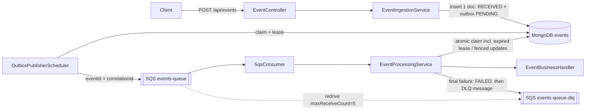
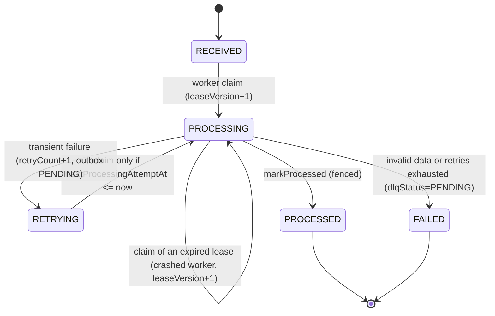
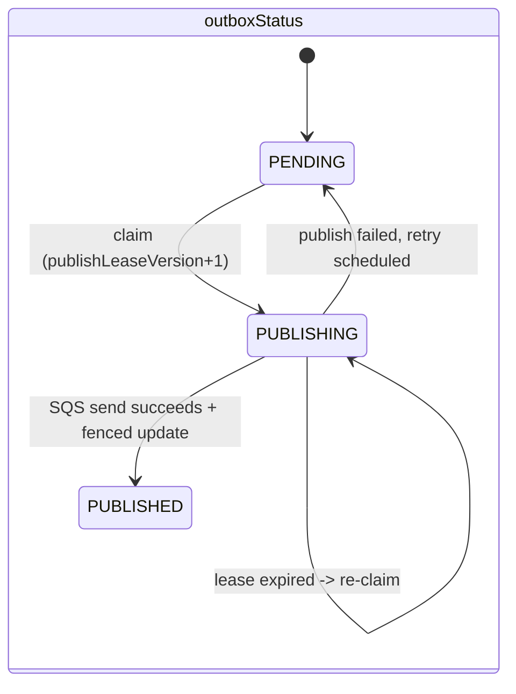

# ARCHITECTURE – Event Processing Service

## 1. Components and Architecture



The application is organized into the following layers:

- `api` — HTTP/REST layer only.
- `application` — application logic, event ingestion, processing, retry/backoff decisions, and metrics.
- `domain` — event domain model and state definitions.
- `infrastructure` — MongoDB, SQS, and the Outbox scheduler.
- `config` — application and infrastructure configuration.
- `exception` — application-specific exceptions and error handling.

The only scheduler in the system is `OutboxPublisherScheduler`. It is responsible only for publishing pending Outbox messages to SQS.

Event processing itself is asynchronous and is performed by `SqsConsumer` and `EventProcessingService`.

The main processing flow is:

```text
Client
  -> REST API
  -> MongoDB (event + Outbox record)
  -> Outbox Publisher
  -> SQS
  -> SQS Consumer
  -> Event Processing Service
  -> Business Logic
  -> MongoDB
```

---

## 2. Technology Choices

The service is implemented using:

- **Java 21** — the application runtime.
- **Spring Boot** — REST API, dependency injection, scheduling, configuration, and application infrastructure.
- **Maven** — build and dependency management.
- **MongoDB** — event persistence, state management, idempotency, leases, Outbox state, retry state, and DLQ state.
- **AWS SQS** — asynchronous event delivery and buffering.
- **LocalStack** — local development and testing of SQS without requiring AWS.
- **Spring Boot Actuator + Micrometer** — application metrics and operational visibility.
- **Docker Compose** — local multi-service environment.

MongoDB is used as the source of truth for event state and processing coordination. SQS provides asynchronous delivery and at-least-once message delivery.

The design intentionally uses a single MongoDB document per event so that event state, Outbox state, worker lease state, retry state, and DLQ state can be updated atomically where required.

---

## 3. MongoDB Event Document

The `events` collection contains a single document for each event.

The document contains:

- Event data.
- `amount` stored as `Decimal128`.
- `status`.
- `retryCount`.
- `nextProcessingAttemptAt`.
- Worker ownership fields:
  - `workerId`
  - `leaseVersion`
  - `processingLeaseUntil`
- Outbox fields:
  - `outboxStatus`
  - `publisherId`
  - `publishingLeaseUntil`
  - `publishLeaseVersion`
  - `outboxNextAttemptAt`
- DLQ fields:
  - `dlqStatus`
  - `dlqPublishedAt`
- `correlationId`.

MongoDB indexes are defined in `MongoConfig`, including the required indexes and partial indexes used by the processing and Outbox flows.

The document is also used for idempotency and concurrency control.

---

## 4. Event State Machine



The main event lifecycle is:

```text
RECEIVED
   |
   v
PROCESSING
   |
   +----> PROCESSED
   |
   +----> RETRYING
   |         |
   |         v
   |     PROCESSING
   |
   +----> FAILED
```

`RETRYING` is entered only when a retryable business failure is persisted.

A worker crash does not increment `retryCount`. Instead, the expired processing lease can be taken over by another worker.

---

## 5. Outbox State Machine



The Outbox follows:

```text
PENDING
   |
   v
PUBLISHING
   |
   +----> PUBLISHED
   |
   +----> PENDING
```

The Outbox is stored in the same MongoDB document as the event. This provides an atomic persistence boundary between creating the event and recording that the event needs to be published.

---

## 6. Outbox

The Outbox publisher performs an atomic claim using `findOneAndUpdate` for either:

```text
PENDING && outboxNextAttemptAt <= now
```

or:

```text
PUBLISHING && publishingLeaseUntil <= now
```

The candidate is ordered by `outboxNextAttemptAt`.

When an SQS publish succeeds, the document is changed to `PUBLISHED` only if:

```text
eventId
+
publisherId
+
publishLeaseVersion
```

still match and the publishing lease is still valid.

If publishing fails, the Outbox returns to `PENDING` with exponential backoff, jitter, and a maximum delay. The update is performed only while the publisher still owns the publishing lease.

Each application instance has a unique `publisherId`.

### Outbox Crash Window

There is an unavoidable crash window:

```text
SQS receives message
        |
        v
Application crashes before MongoDB is updated to PUBLISHED
        |
        v
Publishing lease expires
        |
        v
Another publisher claims the Outbox record
        |
        v
Message may be published again
```

Therefore, the Outbox does not provide Exactly-Once delivery.

The Worker side is designed to be idempotent so that a duplicate SQS message does not result in duplicate business processing.

---

## 7. Worker, Lease, and Fencing

When a message is received, the worker performs an atomic `claimWorkerEvent` operation using `findAndModify`.

The claim can apply to:

- `RECEIVED` events.
- `RETRYING` events whose `nextProcessingAttemptAt` has been reached.
- `PROCESSING` events whose processing lease has expired.

A successful claim changes the event to:

```text
status = PROCESSING
processingLeaseUntil = now + 30 seconds
leaseVersion = leaseVersion + 1
```

### Lease and Visibility Timeout

The current implementation does not renew the worker lease and does not extend the SQS Visibility Timeout.

The configured values are:

```text
Worker lease:       30 seconds
SQS Visibility:     60 seconds
```

The Visibility Timeout is intentionally longer than the worker lease. Normal event processing is expected to complete significantly faster than these limits.

### Fencing

Every result update is protected by the current worker ownership information:

```text
status = PROCESSING
workerId = current worker
leaseVersion = current lease version
processingLeaseUntil > now
```

This applies to operations such as:

- `markProcessed`
- `scheduleRetry`
- `markFailed`

A stale worker whose lease has expired or has been replaced cannot update the event.

If MongoDB rejects an update because ownership was lost:

```text
lease lost
    |
    v
exception
    |
    v
events.worker.lease.lost
    |
    v
NO ACK
    |
    v
SQS redelivery
```

### Worker Crash Recovery

```text
Worker crashes
      |
      v
No ACK
      |
      v
SQS Visibility Timeout expires (60s)
      |
      v
SQS redelivers message
      |
      v
Atomic worker claim
      |
      v
Expired processing lease is taken over
      |
      v
leaseVersion + 1
      |
      v
Processing continues
```

A worker crash therefore does not require a separate recovery scheduler. Recovery occurs through SQS redelivery combined with the expired worker lease.

---

## 8. Retry and Recovery

`retryCount` starts at `0` when the event is ingested.

It is incremented only when a retry is explicitly scheduled because of a temporary business failure.

The following do **not** increment `retryCount`:

- duplicate SQS delivery,
- worker crash,
- takeover of an expired worker lease.

SQS provides an additional protection against repeated message-level failures through:

```text
maxReceiveCount = 5
```

The business retry policy allows:

```text
3 retries
4 total business processing attempts
```

After the fourth failed business attempt, the event is marked `FAILED` and a DLQ message is produced.

### Retry Persistence

Scheduling a retry is persisted atomically:

```text
status = RETRYING
retryCount = retryCount + 1
nextProcessingAttemptAt = calculated time
outboxStatus = PENDING
outboxNextAttemptAt = calculated time
```

The old SQS message is acknowledged only after this retry decision has been successfully persisted.

This prevents losing the event between the processing failure and the retry decision.

### Backoff

The current business retry backoff is:

```text
5s * 3^(n-1)
```

with:

```text
20% jitter
maximum delay = 300 seconds
```

### Failure Classification

The processing logic distinguishes between:

- `RetryableBusinessException` — retry the business operation.
- `NonRetryableBusinessException` — fail immediately.
- Unexpected exceptions — treated as retryable according to the processing policy.
- MongoDB unavailable after message reception — do not change the event state and do not ACK the SQS message.

---

## 9. Duplicate Prevention and Idempotency

The system provides duplicate protection at multiple levels.

### HTTP Idempotency

`eventId` is unique in MongoDB.

When a POST request is received:

- New `eventId` + new payload → create event and return `202 RECEIVED`.
- Existing `eventId` + identical payload hash → treat as an idempotent duplicate.
- Existing `eventId` + different payload hash → return conflict (`409`).

The payload hash is canonicalized before hashing so that equivalent JSON structures produce the same logical hash.

### Worker Idempotency

SQS provides at-least-once delivery, so the same message may be delivered more than once.

The worker prevents duplicate business execution through:

- atomic event claim,
- worker lease,
- `leaseVersion`,
- fencing,
- final-state detection.

Two workers cannot successfully claim the same active event simultaneously.

### External Business Operation

The business operation receives the constant `eventId` as its idempotency key for every attempt.

This allows an external operation to recognize repeated attempts for the same logical event.

---

## 10. DLQ

For a final business failure, the worker first persists:

```text
status = FAILED
dlqStatus = PENDING
```

using a fenced update.

It then sends a DLQ message containing:

```json
{
  "eventId": "...",
  "correlationId": "...",
  "errorMessage": "...",
  "retryCount": "...",
  "timestamp": "..."
}
```

After a successful SQS DLQ send, the event is updated to:

```text
dlqStatus = PUBLISHED
```

### DLQ Publish Failure

If the DLQ send fails:

```text
FAILED + PENDING
      |
      v
DLQ send fails
      |
      v
No ACK
      |
      v
SQS redelivery
      |
      v
FAILED + PENDING is detected
      |
      v
DLQ publication is retried
```

If the DLQ send succeeds but the subsequent MongoDB update fails, a duplicate DLQ message is possible.

DLQ consumers should therefore use `eventId` for idempotency.

### SQS Redrive

The SQS queue also has a redrive policy:

```text
maxReceiveCount = 5
```

This provides a safety net for messages that repeatedly fail at the message-consumption level.

Business retry and SQS redrive serve different purposes:

- Business Retry handles expected temporary business failures.
- SQS Redrive handles messages that repeatedly fail to be processed or acknowledged.

---

## 11. Scaling Approach

The service is designed to support horizontal scaling.

Multiple application instances can run simultaneously:

```text
                    +--> Worker Instance 1
                    |
SQS events-queue ---+--> Worker Instance 2
                    |
                    +--> Worker Instance 3
```

SQS distributes messages among consumers.

MongoDB provides the coordination required to prevent concurrent processing of the same event:

- atomic worker claims,
- worker leases,
- fencing tokens,
- conditional state updates.

The Outbox publisher also uses atomic claiming and publisher leases, allowing multiple application instances to participate without allowing the same Outbox record to be owned by multiple publishers simultaneously.

The main scaling parameters are:

- number of application instances,
- SQS consumer concurrency,
- MongoDB capacity,
- Outbox publishing throughput.

Horizontal scaling should therefore primarily increase worker concurrency while monitoring MongoDB contention and queue depth.

---

## 12. Potential Bottlenecks and Scaling Risks

The main potential bottlenecks are:

### MongoDB

MongoDB is used for:

- event persistence,
- idempotency checks,
- worker claims,
- lease management,
- retry scheduling,
- Outbox claims,
- DLQ state management.

High concurrency can therefore create contention around atomic updates.

Proper indexes and selective queries are important to maintain throughput.

### Outbox Polling

The Outbox publisher periodically scans for publishable records.

If event ingestion becomes significantly faster than Outbox publishing, pending Outbox records can accumulate.

The `outboxNextAttemptAt` index and partial indexes reduce unnecessary scanning.

### SQS Consumer Concurrency

Increasing worker concurrency improves throughput until MongoDB or the business operation becomes the limiting factor.

Concurrency should therefore be increased together with monitoring of:

- queue depth,
- processing latency,
- MongoDB latency,
- CPU and memory,
- error rate.

### Long-Running Business Operations

The current implementation does not renew the worker lease or extend the SQS Visibility Timeout.

Therefore, processing that lasts longer than the configured timing assumptions can cause:

- lease expiration,
- message redelivery,
- another worker taking ownership,
- additional business attempts.

For long-running production workloads, lease renewal and coordinated Visibility Timeout extension would be required.

### Customer Event Pagination

The customer event API uses pagination. Offset-based pagination can become less efficient for very large result sets.

For significantly larger production datasets, cursor-based pagination could be considered.

---

## 13. AWS Deployment

The local environment uses Docker Compose and LocalStack for development.

A proposed production AWS deployment is:

```text
                    Internet / Clients
                           |
                           v
                     Load Balancer
                           |
                           v
                 ECS / Fargate Service
                  +--------+--------+
                  |        |        |
                  v        v        v
               Task 1   Task 2   Task N
                  |        |        |
                  +--------+--------+
                           |
              +------------+------------+
              |                         |
              v                         v
        MongoDB / Atlas              AWS SQS
              |                         |
              |                  +------+------+
              |                  |             |
              |               Main Queue      DLQ
              |                  |
              +------------------+
```

Recommended production components:

- **ECS/Fargate** for horizontally scalable application instances.
- **Amazon SQS** instead of LocalStack.
- **MongoDB Atlas** or another managed MongoDB deployment.
- **IAM roles** for AWS access instead of static AWS credentials.
- **AWS Secrets Manager** for secrets and sensitive configuration.
- **Application Load Balancer** when external HTTP load balancing is required.
- **CloudWatch** for production logs, metrics, and alarms.

The AWS architecture is a proposed production deployment model. The submitted project itself is designed to run locally using Docker Compose and LocalStack.

---

## 14. Monitoring and Observability

The application exposes operational metrics through Spring Boot Actuator and Micrometer.

Important custom metrics include:

```text
events.ingested
events.ingest.duplicates
events.ingest.conflicts
events.processing.time
events.retries
events.outbox.failures
events.dlq.failures
events.dlq.published
events.worker.lease.lost
events.by.status{status}
events.oldest.unprocessed.age.seconds
events.outbox.oldest.pending.age.seconds
events.sqs.queue.messages
```

Standard Spring Boot, JVM, system, HTTP, MongoDB, executor, and scheduling metrics are also available through Actuator.

### Structured Logging

Logs include correlation and processing information such as:

```text
correlationId
eventId
workerId
leaseVersion
```

This allows a request or event to be followed through the asynchronous processing pipeline.

### Production Monitoring

In AWS production, these metrics and logs can be integrated with CloudWatch.

Recommended alarms include:

- high number of `FAILED` events,
- increasing retry rate,
- DLQ messages,
- DLQ publishing failures,
- Outbox failures,
- growing Outbox backlog,
- increasing SQS queue depth,
- increasing oldest unprocessed event age,
- worker lease losses,
- abnormal processing latency,
- high HTTP error rate,
- MongoDB connectivity or latency problems.

The objective is to detect both immediate failures and gradual backlog or latency degradation.

---

## 15. Configuration and Graceful Shutdown

MongoDB connection timeouts are configured through the application connection settings.

The application uses:

```text
server.shutdown=graceful
```

to support graceful application shutdown.

Worker concurrency is configurable through:

```text
max-concurrent-messages
```

This allows the deployment to control the number of messages processed concurrently and tune throughput according to available resources.

---

## 16. Reliability Guarantees and Known Limitations

The system provides:

- REST-level idempotency.
- Unique `eventId`.
- Canonical payload hashing.
- Atomic worker claims.
- Worker leases.
- Fencing through `leaseVersion`.
- At-least-once SQS processing.
- Business retries with persisted retry decisions.
- Exponential backoff with jitter.
- Outbox-based event publication.
- Outbox publisher lease and recovery.
- Direct business DLQ publication.
- SQS redrive as an additional safety mechanism.
- Correlation IDs and operational metrics.

The system does **not** claim Exactly-Once processing.

The following limitations are intentional and documented:

1. Worker lease renewal is not implemented.
2. SQS Visibility Timeout extension is not implemented.
3. Long-running processing beyond the configured timing assumptions can result in lease loss and redelivery.
4. A crash between successful SQS publication and the MongoDB `PUBLISHED` update can produce a duplicate SQS message.
5. A crash after successful DLQ publication but before the MongoDB DLQ state update can produce a duplicate DLQ message.
6. Repeated message-level failures are ultimately limited by the SQS `maxReceiveCount` policy.
7. Offset-based pagination may become less efficient for very large datasets.

These limitations are acceptable for the current implementation and should be addressed or further hardened for a production workload with significantly longer processing times or higher scale.

---

## 17. Summary

The architecture follows an asynchronous, durable event-processing model:

```text
REST API
   |
   v
MongoDB
   |
   | Outbox
   v
SQS
   |
   v
Worker
   |
   +--> Atomic Claim
   +--> Lease
   +--> Fencing
   +--> Business Logic
   +--> Retry / Backoff
   +--> FAILED / DLQ
   |
   v
MongoDB
```

The design separates ingestion from asynchronous processing, uses MongoDB as the coordination and persistence layer, uses SQS for durable asynchronous delivery, and provides multiple layers of duplicate protection and failure recovery.

The architecture is designed around **at-least-once delivery**, explicit state transitions, atomic ownership claims, fencing, persisted retry decisions, and operational observability.
